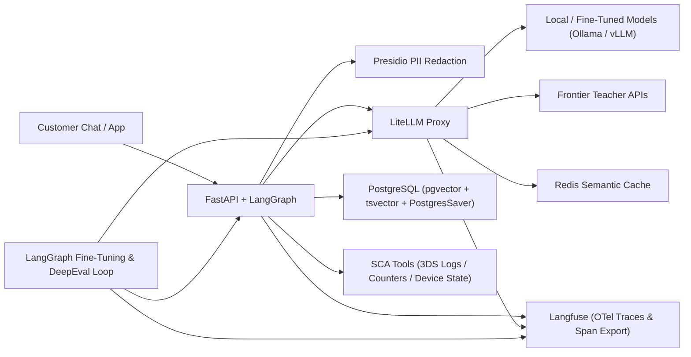
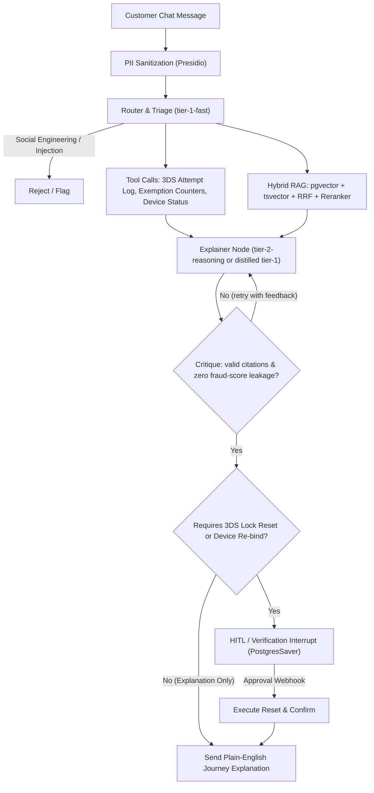

# DeepEvalFineTune — Applying Evals & Fine-Tuning to AI Products

This project explores and improves how LLM evaluation (**DeepEval**) is done in industry, providing a hands-on way to understand how model outputs can be judged across different tests and methodologies. Using those evaluation results, we can systematically **fine-tune** models to achieve higher-quality outputs going forward.

## Product Domain

To simulate a real-world business product, this project focuses on **SCA (Strong Customer Authentication)**. This protocol is generally complex and hidden behind a black box, leaving engineering teams, product owners, business analysts, and customers confused about which part of the authentication journey failed and ultimately caused a transaction to fail.

Some of the key questions commonly asked include:
1. *"Why did my payment just get declined at checkout?"*
2. *"Why did it ask for extra factors to authenticate with when it's a low-value transaction?"*
3. *"Why didn't I get any factors to authenticate with?"*

The system:
- Inspects real-time SCA telemetry, 3DS2 session logs, and cumulative exemption counters (such as contactless tap totals and low-value transaction limits).
- Cross-references SCA exemption rules and 3DS error code dictionaries.
- Translates cryptic payment gateway responses into plain-English customer explanations—while strictly withholding internal fraud-engine risk scores.
- Pauses at a checkpoint for verification or agent approval before executing account mutations (like clearing a 3DS soft-lock or re-binding a device).

The sample product is the vehicle; the focus is on **eval-driven development**: establishing a baseline with DeepEval early, measuring the lift of every architectural change (RAG, reranking, guardrails), and closing the loop with an automated **LangGraph fine-tuning & teacher-distillation workflow**.

---

## 1. System Topology & Tech Stack

This architecture mirrors production fintech microservices so that evals and fine-tuning are exercised against realistic components (routing, tool calls, hybrid retrieval, structured outputs, and human-in-the-loop checkpoints).

| Layer | Technology | Role in the Project |
|---|---|---|
| **Core API & State Orchestrator** | Python 3.13 + FastAPI + LangGraph | Runs the stateful chatbot workflow, manages checkpoints in Postgres, and exposes streaming SSE & REST endpoints. |
| **Downstream Domain Services** | C# Mock API | Simulates the SCA Telemetry Service (3DS2 logs), Exemption Counter Service (cumulative tap/spend limits), and Device Binding Registry. |
| **AI Gateway & Routing** | LiteLLM Proxy | Unifies local models (Ollama / vLLM / ROCm) and frontier APIs with token budgets, semantic caching (Redis), and automatic fallback chains. |
| **Knowledge & Retrieval Store** | PostgreSQL (`pgvector` + `tsvector`) | Stores SCA exemption rules, EMV 3DS2 reason code dictionaries, and customer device troubleshooting guides for Hybrid Search + Reciprocal Rank Fusion (RRF). |
| **Guardrails & Privacy** | Microsoft Presidio + Pydantic | Redacts customer PII (PANs, phone numbers, device IDs, OTPs) before prompts leave the boundary; enforces strict schema validation on all LLM outputs. |
| **Observability & Dataset Harvesting** | Langfuse (self-hosted via Docker) | Captures OpenTelemetry traces of every graph node, prompt version, token cost, and latency percentile; exports node-level spans for fine-tuning. |
| **Automated CI/CD Evals** | DeepEval + `Synthesizer` + pytest | Generates synthetic golden datasets and tests retrieval precision/recall, RAG faithfulness, tool correctness, and custom security/clarity rubrics (`GEval`). |
| **Eval-Driven Fine-Tuning Loop** | LangGraph + LangChain + DeepEval + TRL/PEFT (LoRA) or OpenAI Fine-Tuning API | Orchestrates a cyclical evaluate → diagnose failure mode → synthesize & mix replay dataset → fine-tune / distill → re-evaluate workflow with human promotion gates. |

---

## 2. End-to-End Product Request Flow

1. **Chat Ingestion & PII Sanitization**
   A customer messages the bot (e.g., *"My card ending 4921 just got declined at Tesco for £18! Why did it ask for a PIN, and why didn't my push notification work on +44 7700 900077?"*). Presidio intercepts the message, replaces sensitive values with deterministic placeholders (`<CARD_TOKEN_1>`, `<PHONE_1>`), and stores the mapping in an ephemeral vault.

2. **Router & Triage Node** (`tier-1-fast` via LiteLLM)
   A lightweight model classifies the inquiry (`unexpected_challenge`, `push_notification_failure`, `soft_decline_explanation`, `unlock_request`), checks for social-engineering / prompt-injection attempts (e.g., trying to trick the bot into bypassing 2FA), and routes the state to the diagnostic subgraph.

3. **Parallel Context Gathering** (Agentic Tool Use + Hybrid RAG)
   - **Tool Call Branch:** Calls internal tools (`get_latest_sca_attempt`, `get_exemption_counters`, `get_device_enrollment_status`) to inspect the exact telemetry of the failed or challenged session (e.g., seeing `status: "CHALLENGE_REQUIRED"`, `reason_code: "SCA_EXEMPTION_CUMULATIVE_LIMIT_EXCEEDED"`, `contactless_spend_since_pin: £154.20`).
   - **Hybrid RAG Branch:** Queries PostgreSQL combining `pgvector` cosine similarity and `tsvector` BM25 keyword search via Reciprocal Rank Fusion (RRF), then passes the top 25 chunks through a local Cross-Encoder Reranker (`BAAI/bge-reranker-v2-m3`) to pull the exact 3DS error code definition, the £150 cumulative contactless rule, and the push-notification troubleshooting steps.

4. **Critique & Reflection Loop** (Self-Correction & Anti-Tipping-Off Check)
   An **Explainer** node drafts a structured response (`SCAExplanationResult`: `journey_stage_failed`, `root_cause_code`, `rule_citations`, `customer_explanation`, `recommended_next_step`, `requires_account_action`). A deterministic/LLM **Critique** node checks two things:
   - Every cited rule/error code ID exists in the retrieved context.
   - **No Fraud-Signal Leakage:** If the telemetry includes an internal risk flag (e.g., `TRA_HIGH_RISK_VELOCITY`), the explanation must cite standard security verification without exposing internal risk thresholds. If it fails, it loops back with feedback.

5. **Human-in-the-Loop (HITL) / Verification Interrupt**
   If `recommended_next_step` requires a state-mutating action—such as clearing a 3DS 3-strike lock or re-registering a lost biometric device—LangGraph (`PostgresSaver`) persists the graph state and pauses execution (`interrupt_before=["execute_sca_reset_node"]`), emitting an event for supervisor review or out-of-band ID verification. Once the webhook callback confirms approval, the graph resumes from the checkpoint.

